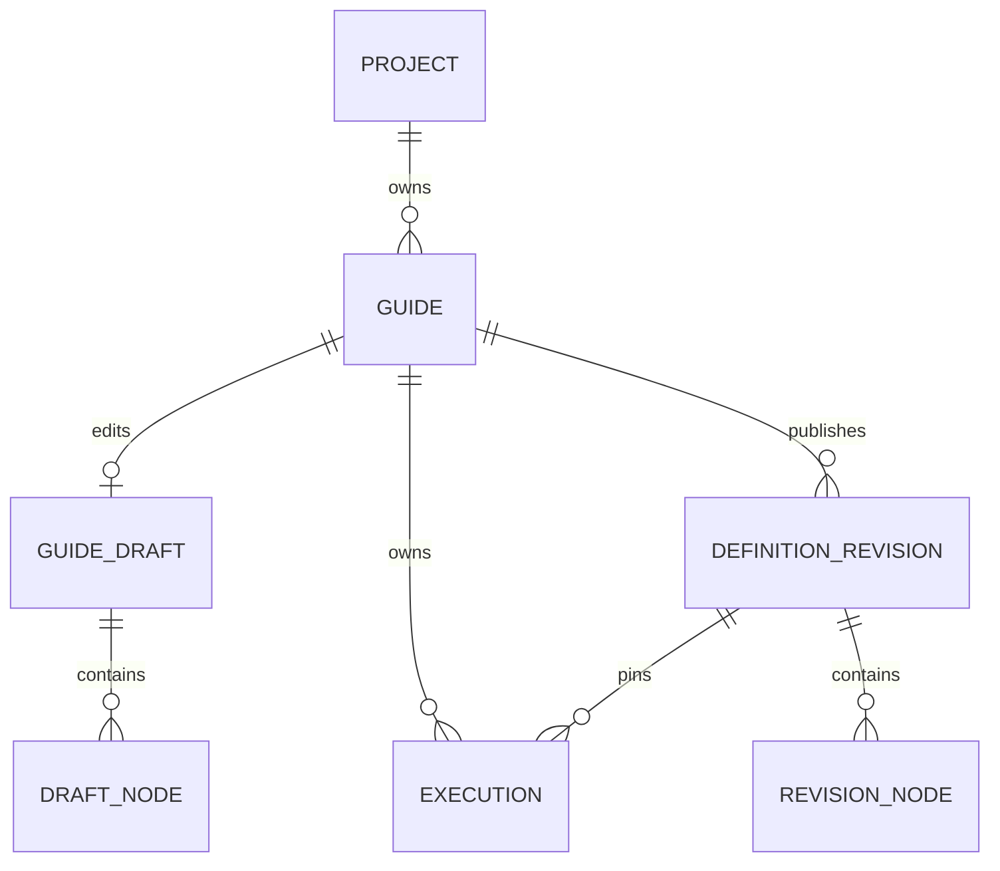
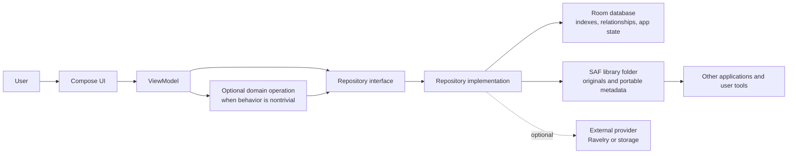
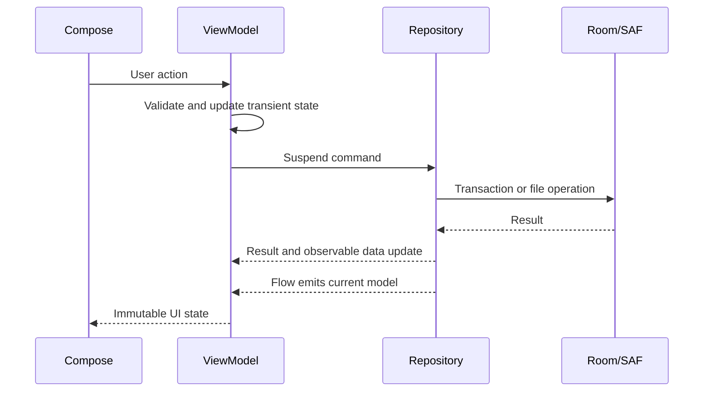

# Stitchbook Architecture

Library reference removal uses a reviewed dependency snapshot (the complete Library item, associated guide IDs and distinct projects from pattern links, guide ownership/use, executions and pieces). `LibraryDao.removeReviewed` compares a fresh snapshot and deletes the index entry in one Room transaction. A changed snapshot returns the updated review without deleting anything; failed writes roll back associated foreign-key updates. The UI retains failed selections and guards busy or stale confirmation events. Original SAF files and retained guide/progress records are never deleted by this action. No schema or export-format change is required.

Pattern-page PDF replacement/unlinking and metadata editing use full-snapshot Room transactions (`changePdfReviewed` and `saveIfUnchanged`). They update existing Library fields only, never recreate removed records, and leave original files and all guide/project work untouched. A different PDF resets the remembered page; the same URI retains it. PDF conflicts refresh the review before another confirmation; metadata conflicts retain typed edits until explicit reload. The shared metadata form scrolls, survives recreation and rejects nonfinite/nonpositive optional yardage. Existing schema25/format4 exports cover all fields. Folder refresh may rediscover an unlinked original as a separate entry; unlinking does not exclude files from future folder imports.

## 1. Status and intent

This document primarily describes the intended architecture. Stitchbook currently has one Android `app` module containing a Material 3 application shell, Room-backed projects, library, stash, tools, counters, yarn allocations, photo references, journal, milestones, and crafting sessions, the pure execution-engine domain model with guide and execution persistence and Focus Mode, PNG share cards, and a versioned JSON backup with reviewed restore. Architecture should continue to be introduced incrementally as product phases require it.

### Current project persistence

The implemented project slice follows the documented data/domain/UI boundaries without a dependency-injection framework:

- `StitchbookApplication` owns a lazy `DefaultAppContainer`.
- The container creates the singleton `StitchbookDatabase` and exposes `ProjectRepository`.
- `LocalProjectRepository` maps between Room entities and the domain `Project`.
- Screen-level ViewModels observe repository `Flow`s and perform save/delete operations.
- Route composables obtain the ViewModels; child composables receive state and callbacks only.

Project-list and project-detail observations are lifecycle-aware and stop upstream Room collection while their destinations have no active subscribers. The project form survives recomposition and ordinary configuration changes because its state is held by its navigation-entry-scoped ViewModel. Unsaved form input is not yet restored after full process death; adding `SavedStateHandle` restoration is deferred, and Room remains the durable source only for successfully saved projects.

Database version 1 introduced the `projects` table:

| Column | Storage | Meaning |
| --- | --- | --- |
| `id` | non-null text primary key | Application-generated UUID string |
| `name` | non-null text | Trimmed project name |
| `craft` | non-null text | Explicit stable craft storage key |
| `project_type` | non-null text | Explicit stable project-type storage key |
| `status` | non-null text | Explicit stable status storage key |
| `notes` | nullable text | Optional private notes |
| `created_at` | non-null integer | Unix epoch milliseconds |
| `updated_at` | non-null integer | Unix epoch milliseconds |

The DAO orders projects by Active, Planned, Paused, Completed, then Abandoned; records within a status are ordered by most recently updated first with deterministic name/ID tie-breakers.

Database version 2 adds persisted guide definitions. Database version 3 adds persisted Execution state. Database version 4 adds `library_items` (pattern references: title, craft, author, source link, comma-joined tags, notes, bookmarked) and `stash_items` (yarn/tool inventory records). Database version 5 adds three nullable columns to `library_items` -- `pdf_uri`, `pdf_file_name`, `pdf_last_viewed_page` -- for an optional PDF attachment selected through the Storage Access Framework; the original PDF is referenced by its persisted-permission `content://` URI only, never copied into the database or app-private storage (see PRODUCT_SPEC.md §6.5). Database version 6 adds the Tools inventory schema (PRODUCT_SPEC.md §6.8): `tool_sets` (a named grouping, such as a complete commercial interchangeable set) and `tool_items` (one physically countable component -- a needle pair, one interchangeable tip, one cable, a bag of markers, and so on), with `tool_items.set_id` an optional foreign key to `tool_sets.id` using `ON DELETE SET NULL` rather than `CASCADE` -- a set is a label over existing inventory, not a second stock count, so deleting the set returns its components to standalone items rather than deleting or orphan-failing them. Sizing and length on `tool_items` are stored canonically in millimeters (`size_metric_mm`, `length_mm`, `stated_cable_length_mm`, `approximate_assembled_length_mm`) alongside an optional free-text convenience label (`size_label`, `cable_length_definition`) that is never the source of truth for a value. `connector_family` and `compatibility_notes` are informational free text, not a validated compatibility database -- an exhaustive global compatibility engine is an explicit non-goal. Many-to-many tool-to-project assignment is not yet modeled; this is the first Tools increment (domain model, migration, and repository only), with bulk creation, CRUD UI, and CSV import/export still to come. Database version 7 adds the Counters schema (PRODUCT_SPEC.md §6.3): a `counters` table (current value, optional goal, a free-text `name`/`unit_label` rather than a closed category enum -- see `domain/model/Counter.kt`'s doc comment for why -- and an optional `project_id` foreign key to `projects.id` using `ON DELETE CASCADE`, the same relationship a Guide already has to its Project). This is the first Counters increment (domain model, migration, and repository only, per ROADMAP.md Phase 3); increment/decrement actions, goals, linked-counter behavior, automatic resets, repeating schedules, an active crafting screen, notifications, and inclusion in the versioned JSON safety export are all still to come. All migrations `1 -> 2` through `6 -> 7` are non-destructive and preserve existing rows. The schema is exported under `app/schemas`; every future schema version must provide and test an explicit migration from each supported prior version and update the exported schema. The production database builder deliberately does not use destructive migration fallback.

Tool sets and items are included in the versioned JSON safety export (`LocalBackupService`) alongside Projects, Library items, and Stash items, per the requirement that every phase adding durable user records extends that export (see ROADMAP.md). Sets are exported and imported before items so an item's `setId` reference always resolves; deleting a set during import or reset only clears `setId` on its components (`ON DELETE SET NULL`), matching the schema's own non-destructive membership rule. *Reset all data* clears guides first, all at once through the guide backup store, because pattern guides belong to no project and would otherwise outlive the projects being deleted.

### Current guide-definition persistence

The v1 guide ownership model is:



- A `Guide` belongs to exactly one project. A project may own multiple guides.
- Guides are not shared or reusable across projects in v1; a future copy operation may create a distinct guide under another project.
- Each guide has at most one editable `GuideDraft`. This is a deliberate database-level constraint — a unique index on the draft's guide-ID column — not merely a repository-layer convention; the schema itself rejects a second draft for the same guide. A draft may be empty or temporarily fail execution-engine validation, but its stored node rows must still form one ownership-safe tree.
- Each `DefinitionRevision` is a validated, immutable snapshot. Its stable revision ID is authoritative; its monotonically increasing per-guide revision number is display and ordering metadata. Revisions are never updated in place and never deleted individually; the only way a revision disappears is as part of a guide-level cascade delete, which is why the draft's reference to its base revision uses `ON DELETE SET NULL` rather than `CASCADE`.
- Draft nodes and revision nodes are separate normalized rows. Composite identities and self-referencing foreign keys preserve stable node IDs, parent ownership, and child order without storing expanded runtime occurrences.
- Publishing runs in one Room transaction: load the draft, map and validate it with the canonical domain validator, allocate the next revision number, insert the revision and its owned node rows, then point the same editable draft at the new base revision. Failure rolls back the whole publication.
- After publication, the draft keeps its own editable node rows as a synchronized copy of the published content. Later draft saves cannot mutate earlier revision rows; publishing a correction creates a new revision.
- Draft replacement uses a small version field for optimistic concurrency so a stale editor cannot silently overwrite a newer save.
- Project deletion cascades through guides to drafts, revisions, and their nodes. Guide deletion has the same aggregate-level cascade below the guide.

The repository layer exposes guide metadata, full-draft aggregate reads and atomic replacement, immutable revision reads, and publication. `GuideRepository.getLatestRevision(guideId)` is the single authoritative implementation of "the Guide's latest published Revision" -- the revision a new Execution starts from, per the Focus Mode entry rule stated below. "Latest" means the highest `revisionNumber` for that guide, which this section already establishes as monotonically increasing per-guide ordering metadata; the method exists so that operational definition lives in exactly one place rather than being reimplemented as ad hoc ordering logic in a ViewModel. (It is implemented by reusing the same `revision_number DESC` query the data layer already used internally for draft creation, but that reuse is an implementation detail -- the rule itself comes from the Focus Mode contract, not from that query.)

`GuideRepository` declares its own `DraftValidationException` and `DraftVersionConflictException` (in `domain.repository`), mirroring `ExecutionVersionConflictException`'s role for Executions: `LocalGuideRepository.saveDraft` translates the concrete data-layer tree-validation and optimistic-concurrency-conflict exceptions into these before they cross the repository boundary, so callers such as the Draft editor's ViewModel depend only on the domain contract, never on a `data.database` type.

### Current execution persistence

The v1 execution ownership model is:

- An `Execution` belongs to exactly one `Guide` and permanently references the exact immutable `DefinitionRevision` it was created from. An Execution never switches revisions: if the owning Guide later publishes a newer revision, every existing Execution keeps pointing at the revision it started with, unaffected. Reviewed reconciliation creates a separate execution on the target revision and retains the original execution and progress.
- A Guide may retain multiple historical Executions. In v1, at most one Execution per Guide may be ACTIVE at a time; this is enforced at the database level by a one-row-per-guide "active execution" pointer table (unique on guide ID), not only by repository-level logic. Completed Executions remain queryable as history; v1 does not support restarting, abandoning, or deleting an individual Execution.
- Persisted execution state is the current pointer (a structural Execution Address: revision ID, Instruction node ID, and ordered ancestry frames — never a display string or list index), the set of completed occurrence addresses, and an explicit ACTIVE/COMPLETED status. Ancestry frames and completed occurrences are stored as normalized ordered rows, not a permanently expanded row per generated runtime step.
- All Complete, Previous, and Jump behavior is delegated to the existing pure execution-engine domain functions; the data layer only loads persisted state into that engine, applies its result, and persists the outcome. It does not reimplement traversal or transition rules.
- Each progress action (Complete, Previous, or Jump) is applied in one Room transaction: load the Execution and its immutable Definition Revision, map to the pure domain model, validate, apply the pure-domain transition, and persist the result atomically, or roll back entirely. This matches the crash-safety and immediate-persistence expectations in [docs/EXECUTION_ENGINE_SPEC.md](docs/EXECUTION_ENGINE_SPEC.md).
- Draft-style optimistic concurrency (a `version` field checked against a caller-supplied expected version) protects each transition the same way it protects Draft saves.
- Deleting a Guide cascades to its Executions. A Definition Revision cannot be deleted independently while an Execution still references it.

### Current Focus Mode

Focus Mode is the first UI consumer of Guide and Execution persistence. Its scope is intentionally minimal:

- Opening a guide continues its selected unfinished execution, shows its most recent completed record when there is no selected unfinished execution, or offers to start from the latest publication when there is no current work. Finished work offers Start next and Guide versions.
- The `GuideFocusViewModel` only loads persisted state via `GuideRepository`/`ExecutionRepository` and renders whatever they return; Complete, Previous, and Jump are single calls into `ExecutionRepository`, never reimplemented in the ViewModel or Compose layer. The screen distinguishes ACTIVE from COMPLETED purely by reading the persisted `ExecutionStatus`, never by a UI-side check such as "is this the last instruction."
- Structural context (Section breadcrumbs, "Row x of y", "Repeat x of y") is derived at render time from the current Execution Address's ancestry frames plus the already-loaded Guide Definition; none of it is stored as new execution state. Rendering Section breadcrumbs specifically needed one small, non-transition addition to the pure engine: `GuideTraversal.ancestryNodePath()`, which exposes the same ancestor-node walk the engine already performs internally (a Section contributes no `AncestryFrame`, so its title cannot be read off an address alone).
- Jump is deliberately narrow in this MVP: the only exposed target is "resume at the earliest incomplete step," computed via the engine's own traversal. A general jump-to-any-occurrence picker is Pattern Map's job and remains out of scope here.
- Because Focus Mode was built before the manual guide editor (delivery-sequence item 3), it operates on whatever Guides and Revisions already exist and never authors content itself; authoring is the Draft editor's job, described below.
- `ExecutionRepository` declares its own `ExecutionVersionConflictException` (in `domain.repository`) as the documented contract for a stale optimistic-concurrency write; `LocalExecutionRepository` translates the concrete data-layer exception into it before it crosses the repository boundary, so callers such as Focus Mode's ViewModel depend only on the domain contract, never on a `data.database` type.
- Focus Mode shows how far through the whole guide the knitter is (`domain/execution/GuideProgressSummary.kt`). Progress is weighted by the stitch counts steps state ("(24 sts)", "— 24 sts", "Cast on 66 sts"). A step without a count takes the last count stated before it, and the label then says the figure is an estimate. Without any counts, every step weighs the same and the label counts steps.
- Focus Mode shows worked time from the project's crafting sessions (`domain/model/KnittingTime.kt`): the project's total, and the time since the current step became current (the execution's `updatedAt`). Only running time counts. When a step began part-way through a session that has pauses, those pauses are shared out and the step time is marked "about". Completing a step starts the project's timer if no timer is running anywhere. *Pause/Resume timer* controls it, and a timer running for another project is left alone. Focus never stops a timer by itself. A guide opened without a project shows no time.
- *Overview* lists the whole guide (sections, row spans, repeats and steps) with done, current and to-do marks; tapping a line jumps there. *Pattern, p.N* opens the guide's pattern PDF at the current step's page. The pattern is the guide's own, or the project's only pattern file, and the page comes from the nearest "(p.N)" at or before the current step, since imported steps note their page only where it changes. Focus hides that suffix from the step text.
- Knitting moves a project along: starting or completing a step in a *Planned* project makes it *Active*, so Home offers to continue it; that card shows the same stitch-weighted percentage as Focus. Using a pattern's size guide in a project also links that pattern to the project.
- A size guide filled from the PDF leaves out the pattern's own "Sizes:" line, since the guide is for one size.
- Focus Mode's presentation is styled entirely through the semantic roles defined by the first version of the Stitchbook design system (`ui/theme`, `ui/components`; see [DESIGN_SYSTEM.md](DESIGN_SYSTEM.md)) rather than hardcoded colors or ad hoc styling. That visual pass changed only rendering: it introduced no new ViewModel state, repository calls, or execution-engine behavior.
- A Project's Guide list is the entry point into Focus Mode and states, per Guide, exactly what its own entry action offers: `ProjectDetailViewModel` resolves one of Continue (an ACTIVE Execution already exists), Start (no ACTIVE Execution, but a published Revision does), or not executable (Draft-only -- a Guide that has never published a Revision) purely by reading `ExecutionRepository.getActiveExecution` and `GuideRepository.getLatestRevision`; it never decides completion, traversal, or revision selection itself, and an ACTIVE Execution always takes priority over Start. A not-yet-executable Guide's card stays tappable, but now opens the Draft editor (described below) instead of Focus Mode -- Focus Mode has nothing to execute for a Guide that has never published a Revision. Navigation into Focus Mode passes only the Guide's stable ID; `GuideFocusViewModel` reloads authoritative Execution and Definition state from Room on every creation, so it renders the same persisted address and completion records after Activity, ViewModel, or process recreation without any navigation-carried execution state.
- Complete, Previous, and the "resume at earliest incomplete step" Jump are each one call into `ExecutionRepository`, guarded by a single `isBusy` flag so a second tap while a write is in flight is a no-op rather than a second concurrent transition; the same flag disables the Complete/Previous/Jump controls in the UI. An `ExecutionVersionConflictException` (another transition committed first) reloads authoritative persisted state and surfaces a recoverable, dismissable feedback message rather than retrying the original transition automatically; the reload itself clears `isBusy`, so the screen is immediately usable again for the next action. This wiring was confirmed by inspection to already exist, and is backed by focused JVM tests for duplicate-submission guarding and post-conflict recovery and a Compose test for the disabled-while-busy render, all of which pass. A production-navigation instrumented test drives Start/Complete/Previous/Continue through the real navigation graph with real persisted state. It runs and passes on an API 36 emulator. It waits for each node rather than for Compose idleness alone, because screens load from Room on a dispatcher Compose does not track. Project detail re-reads each guide's Start/Continue state when it resumes, since starting an Execution elsewhere changes no guide row.

### Current guide authoring

The manual guide editor (delivery-sequence item 3) now covers the full authoring loop end to end: creating a Guide, editing its Draft, publishing it, and reaching Focus Mode -- delivered as two slices, Draft Editor Foundation and Publish and Knit.

- A Project's "Add Guide" action calls `GuideRepository.createGuide` (which also creates the Guide's one empty Draft, per the schema above) and navigates straight into the Draft editor for the new Guide; there was previously no in-app way to reach this repository method at all.
- The Draft editor (`feature/draft`) renders the Draft's node tree as a flattened, indented outline (`DraftEditorViewModel` computes this by walking `rootNodeIds`/`children`; the screen never walks the tree itself) supporting the four node types the canonical model already defines: Section, Range, Repeat, Instruction. Add, edit, delete (cascading to descendants), and reorder-within-siblings are each one `GuideRepository.saveDraft` call; there is no separate longer-lived unsaved buffer the ViewModel could let diverge from what Room holds -- `uiState` always reflects either the last successfully persisted Draft or, while a save is in flight, the previously persisted one.
- A structural save failure (`DraftValidationException`) or an optimistic-concurrency conflict (`DraftVersionConflictException`, another save committed first) each surface a recoverable, dismissable message and leave the editor on the last known-good persisted state -- reusing the same reload-on-conflict shape Focus Mode already established for Executions -- rather than crashing or silently discarding the attempted edit.
- Publishing is one `GuideRepository.publishDraft` call from a Publish action in the same editor. `LocalGuideRepository.publishDraft` translates every publish-time failure into the same two domain exceptions saving already uses: field-completeness and content/structure errors (a missing required field, an empty container, invalid Range bounds, and so on) become `DraftValidationException`; the draft row being concurrently changed or gone becomes `DraftVersionConflictException` -- there is no separate publish-specific exception type, and no UI code independently guesses whether a Draft is valid before offering Publish. A successful publish reloads the Draft (its `base_revision_id`/`version` changed as part of publishing) so the next save never spuriously conflicts against the pre-publish version, then re-checks `GuideRepository.getLatestRevision`/`ExecutionRepository.getActiveExecution` to decide whether to offer Start or Continue. The Draft remains fully editable afterward -- a later correction publishes as a new Revision the same way, the domain's monotonic-revision-number guarantee applies unchanged.
- Once published, the editor offers "Start Knitting" or "Continue Knitting" (Continue whenever an ACTIVE Execution already exists, exactly the same "ACTIVE always wins" rule `ProjectDetailViewModel` already applies) as a direct, obvious next action; tapping it only navigates to Focus Mode for that Guide -- it never creates or mutates an Execution itself, since Focus Mode's own Start action already owns that.
- A small set of manual-testing-driven usability corrections ship alongside Publish, scoped to copy and layout only, not new behavior: a plain-language empty-state prompt, a one-line explanation next to each node type at the point of choice in the "choose a step" dialog, the Range type's user-facing label changed to "Row range", the Instruction field's label changed to "What to knit", the Repeat count field's label changed to "How many times?", and the bottom action row reorganized so Publish (and, once published, Start/Continue Knitting) reads as the obvious primary action rather than competing evenly with Add step/Done.
- This wiring was confirmed by inspection to exist and is backed by passing focused JVM tests (`DraftEditorViewModelTest`, plus `ProjectDetailViewModelTest` coverage for guide creation) covering add/edit/delete/reorder for every node type, publish success, publish-time validation feedback, publication leaving the Draft editable, Start/Continue exposure, duplicate-submission guarding, and conflict recovery, plus a presentation-only Compose test (`DraftEditorScreenTest`) for the revised copy and action hierarchy. Three production-navigation instrumented tests (adding a Guide and authoring a step; publishing a Guide and reaching Focus Mode's Ready-to-start screen; a Draft-only Guide's card opening the editor) run and pass on an API 36 emulator.

### Current PDF text extraction

The first increment of the deterministic PDF parser (ROADMAP.md's "Parser foundation" item and Phase 12) is implemented: extracting a PDF's digital text layer with page/line provenance, nothing more.

- `domain/parsing/SourceReference.kt` defines the pure domain model: `SourceReference` (1-based page and line number), `ExtractedLine` (text plus its `SourceReference`), and `ExtractedDocument` (a page count plus its extracted lines). A page that yields no text -- for example a scanned image with no text layer -- simply contributes no lines rather than failing the whole document; `ExtractedDocument.pagesWithoutText()` names exactly which pages those are, which is what a later OCR-fallback increment needs to decide where OCR is required.
- `domain/parsing/PdfTextExtractor.kt` declares the extraction contract as `fun extract(input: InputStream): ExtractedDocument` -- an `InputStream`, not a `Uri`, so the domain contract stays platform-agnostic; opening a PDF's `content://` URI is a caller concern.
- `data/parsing/PdfBoxTextExtractor.kt` implements it using the PdfBox-Android library (`com.tom-roush:pdfbox-android`, Apache-2.0 licensed), extracting one page at a time with `PDFTextStripper` and splitting each page's text into non-blank lines.
- PdfBox-Android reads its encoding and glyph-list resources through `PDFBoxResourceLoader`, which is backed by Android's `AssetManager` and therefore needs a real Android `Context` -- it cannot run under a plain JVM unit test. `PdfBoxTextExtractorTest` exercises the real extractor against a synthetic, hand-written two-page fixture built on the fly by `PdfFixtures` (no binary PDF is committed, and its text is original, not copied from any real pattern, per AGENTS.md), so it is an instrumented test. It runs and passes on an API 36 emulator. `ExtractedDocumentTest` covers the pure domain model (validation, `hasNoExtractableText`, `pagesWithoutText`) as an ordinary JVM unit test.
- `domain/parsing/PatternTextParser.kt` is the second increment: a deterministic, line-by-line parser turning an `ExtractedDocument` into a `ParsedPattern` (`domain/parsing/ParsedPattern.kt`'s `ParsedSection`/`ParsedRange`/`ParsedRepeat`/`ParsedInstruction`, each keeping its line's `SourceReference`, plus a `ParsingIssue` list). It recognizes a small, explicit, documented subset of pattern-text conventions -- `Section: <title>`, `Row <n>:`/`Round <n>:`, `Rows <x>-<y>:`/`Rounds <x>-<y>:`, and `Repeat row(s)/round(s) <x>[-<y>] <n> times.` (matching a preceding range node or a contiguous run of single-row instructions, per EXECUTION_ENGINE_SPEC.md's §14.2/§14.3 examples) -- and never guesses: an unrecognized line becomes a plain instruction, while a line that looks like one of these forms but doesn't resolve cleanly (a malformed row line, or a Repeat whose target isn't the trailing, contiguous content of its Section) becomes a `ParsingIssue` instead of silently reinterpreting or reordering anything. This is pure domain logic over plain text with no PDF or Android dependency, so unlike the extractor above it is fully covered by ordinary JVM unit tests (`PatternTextParserTest`), including regression fixtures for EXECUTION_ENGINE_SPEC.md's own §14.1-§14.3 worked examples.
- `domain/parsing/PatternMetadataSplitter.kt` runs between cleanup and parsing. It splits the pattern's front matter (intro, designer, gauge, yarn, tools, sizes, abbreviations) into `PatternDetails` and passes only the instruction lines to the parser. `PatternTextParser.parseWithDetails` returns both. For a pattern guide, `CreateGuideFromPdfUseCase` copies the details into the Library entry's empty fields through `LibraryRepository` and never overwrites the user's own text.
- The third increment maps `ParsedPattern` into the Draft editor's own `DraftNode` tree shape (`domain/parsing/ParsedPatternMapper.kt`) and ties extraction, parsing, and Guide/Draft creation together in one operation (`domain/usecase/CreateGuideFromPdfUseCase.kt` -- the project's first use case, justified per §4's "behavior spans repositories or contains nontrivial rules"). Rather than a schema change or a separate review screen, provenance and ambiguity are kept visible by writing directly into the same free-text fields the existing Draft editor already renders: every generated Instruction's text is suffixed with its page/line source reference, and every `ParsingIssue` becomes its own clearly marked, directly editable/deletable Instruction node appended at the root ("Review needed: ..."). A Project's guide list gets a second entry point next to "Add Guide": "Create from PDF" opens a name dialog, then an `ACTION_OPEN_DOCUMENT` picker (mirroring the Library PDF-attach flow's `pickPdfLauncher` pattern); the picked file's bytes are read once into memory (no persisted URI permission needed, unlike Library's long-lived attachment) and handed to the use case. A PDF with no extractable text (`ExtractedDocument.hasNoExtractableText`) is reported directly rather than creating an empty Guide -- OCR fallback for that case is the next increment. The resulting Draft is never published automatically; it opens in the existing Draft editor via the same `guideCreatedEvents` navigation the manual "Add Guide" flow already used.
- The fourth and final increment of this slice adds on-device OCR as a fallback for any page with no digital text layer at all (`data/parsing/PdfPageOcr.kt`'s contract, backed by ML Kit's bundled, no-network Latin text recognizer in `data/parsing/MlKitPdfPageOcr.kt`). `PdfTextExtractor.extract` is now `suspend` (ML Kit's recognizer is Task/callback-based) and `PdfBoxTextExtractor` reuses the same already-open `PDDocument` to rasterize only the pages digital extraction found nothing on (via PdfBox-Android's own `PDFRenderer`, not Android's `android.graphics.pdf.PdfRenderer` used elsewhere in this codebase -- reusing the already-loaded document avoids re-opening the `InputStream`, which generally cannot be re-read from the start). A rendering or recognition failure for one page is not fatal to the whole document; that page simply contributes no lines, the same as a page with no text ever did. `CreateGuideFromPdfUseCase` now runs extraction (PDFBox parsing plus any OCR) under `Dispatchers.IO` rather than the caller's dispatcher, since a ViewModel's `viewModelScope` defaults to Main and OCR inference is real, non-trivial work. `PdfBoxTextExtractorTest` gained a third case exercising the real OCR path against a synthetic image-only-page fixture (`PdfFixtures.buildImageOnlyPagePdf`, an Android-`Canvas`-drawn word embedded as a raster image with no text content stream) -- and, like every instrumented test in this project, it runs and passes on an API 36 emulator. Size selection remains a later increment beyond this slice (Phase 12 continues).

### Current schema (version 26)

Versions 15–18 add, in order: project description, construction method, custom type label, and start/target/completed local dates (v15); yarn allocations, measured stash weights, extra pattern metadata (gauge, sizes, yardage required, recommended tools, Ravelry pattern ID), and project–pattern links (v16); photo references, journal entries, and milestones (v17); crafting sessions (v18).

Version 19 lets a guide belong to a pattern and size as well as to a project:
- `guides.project_id` becomes optional, and `guides` gains `library_item_id` (`ON DELETE SET NULL`) and `size_label`.
- `project_guides` records which pattern guides a project uses.
- `observeGuides(projectId)` returns a project's own guides plus the guides it uses.
- Deleting a project removes only its own guides; deleting a Library entry keeps its guides and clears their pattern.
- Each Library card has a **Guides** link to the pattern's own screen (`feature/library/PatternGuidesScreen.kt`). It shows the original file and the guides by size; *New guide for a size* creates a draft and opens it in the Draft editor. The draft is empty, or, with *Fill from the pattern*, parsed from the pattern's PDF with only that size's numbers kept (`domain/parsing/PatternSizes.kt`, `CreateGuideFromPdfUseCase.forPattern`).
- In a project's Guides sheet, *Use a pattern guide* links one of those guides to the project.
- Relaxing `NOT NULL` needs SQLite's rename-and-copy rebuild. `legacy_alter_table` keeps child tables pointing at the name `guides`, so the rebuild can't cascade, and a `foreign_key_check` ends the migration.

Version 20 keeps progress per project, so one pattern guide used by two projects keeps a separate place in each:
- `executions` gains `project_id`, filled from each guide's project. It is null when the guide was opened on its own.
- `active_executions` is keyed by `guide_id` and `project_key` (the project, or "" for none), so each project has at most one active progress record per guide.
- The Focus and Draft editor routes take an optional `projectId`; project detail and Home resume pass it.
- Changing the primary key needs a rebuild of `active_executions`. Nothing references that table, so every row is copied and a `foreign_key_check` ends the migration.

Every step is an explicit, non-destructive migration in `data/database/StitchbookDatabase.kt`, collected in `ALL_MIGRATIONS`; schemas 1–26 are exported under `app/schemas`. `StitchbookMigrationTest` builds a real version-14 database from `14.json` with Room's `MigrationTestHelper` and validates 14 → 26 against the current export. A separate 18 → 19 test seeds guides, drafts, revisions, and in-progress progress with foreign keys switched on, then proves every row survives. A 19 → 20 test proves every place in progress stays under its project.

### Current project hub

Project detail is the hub every other record connects to. `ProjectDetailViewModel` exposes, beside its main `uiState`, a `connections` flow (counts of guides, linked patterns, distinct allocated yarns, assigned tools, project counters, journal items, and worked time), the project's live counters, and the whole toolbox. The repositories behind them are optional constructor parameters, so a screen or test that doesn't need the hub doesn't supply them. Node placement (`hubNodePositions`), the next-step rule (`nextStepFor`), and each craft's suggested tool categories (`Craft.suggestedToolCategories`) are pure functions in `domain/model/ProjectConnections.kt`.

Records added from the hub are ordinary shared records: a tool created there is saved to the toolbox and assigned to the project in one step, linking an existing tool keeps its other projects, and a counter created there is a project-owned counter that also appears on the Counters screen. There is no separate per-project copy of anything.

### Current crafting sessions and statistics

A `CraftingSession` stores only wall-clock timestamps (`startedAt`, `endedAt`, `pausedAt`, accumulated `pausedTotalMillis`) and the device time zone at start (`zoneId`). Nothing ticks in the background, so a running or paused session survives process death and needs no service or WorkManager job.

**Day-boundary rule:** a session counts entirely toward the local calendar date on which it *started*, in the zone recorded when it started. A session from 23:30 to 00:30 is one hour on the first day, and travelling to another zone never moves past sessions to a different day. Streaks, per-day and per-week totals, and range filters all use this date.

`computeStatistics` (`domain/statistics/CraftingStatistics.kt`) is a pure function of sessions, projects, allocations, and stash items, so correcting any record simply recomputes every figure. Each figure carries a provenance: **recorded** (timed or entered), **derived** (exact arithmetic over recorded values), or **estimated** (depends on an assumption such as stitches per row or yards per unit), and the UI labels estimates as such. Yarn-consumption records have no per-use date, so yarn figures are all-time regardless of the selected range.

### Current backup format (version 5)

`LocalBackupService` (`data/backup`) exports and restores the library as one JSON document written through `ACTION_CREATE_DOCUMENT`. The JSON shape lives in `BackupJsonCodec.kt`; validation, comparison, and merge selection are pure functions in `domain/backup`.

- **Top level:** `format` (`"stitchbook-backup"`), `version` (5), `exportedAt` (epoch millis), `manifest`, then one array per record type: `projects`, `libraryItems`, `stashItems`, `toolSets`, `toolItems`, `toolTemplates`, `toolAssignments`, `counters`, `counterNotes`, `yarnAllocations`, `patternLinks`, `milestones`, `photos`, `journalEntries`, `sessions`, and the guide graph: `guides`, `guideDrafts`, `guideRevisions`, `executions`, `activeExecutions`, `projectGuides`, `projectPieces`.
- **Manifest:** `recordCounts` per type, `externalFiles` (every referenced PDF and photo: kind, record ID, URI, display name), and a plain-language `fileRule`.
- **Absent versus empty:** an absent array means "this file doesn't carry that type", and a restore leaves that type untouched; an empty array means "the library has none of these". An absent field reads as null.
- **Older versions:** each version is a superset of the one before. Version 1 had no `format` marker or manifest and fewer types and fields; version 2 had no guide graph. Versions 1–4 still preview and restore; version 3 has guides but no named pieces. Older guide graphs represent an empty piece list for reviewed graph replacement. Newer fields take their defaults and absent guide arrays leave guides untouched. A file whose `version` is newer than the app supports is rejected before anything is written.
- **Not included:** unknown fields from a newer writer are not yet preserved on re-export. A per-project JSON export carries the guides the project knits from (its own and the pattern guides it uses, with their patterns), their drafts and revisions, and only that project's progress; another project's place in a shared guide stays out. The Markdown export writes those guides out as plain nested steps with this project's step count.

**Guide graph.** The seven guide arrays copy the stored rows exactly, so a restore reproduces revision numbers, draft and progress versions, and completed steps without re-running publication or the execution engine. Draft and revision node trees are nested in their draft or revision; progress (`executions`) nests its current-position frames and completed steps; `activeExecutions` names which progress is resumed for each guide, project key and piece key (`""` for a guide opened on its own). The rules:

- A file carries all six arrays or none; a partial graph is rejected, because replacing revisions without the progress pinned to them would orphan that progress.
- Validation checks the graph's own keys before writing: children belong to a guide in the file, a draft builds on and progress follows a revision of the same guide, revision numbers are unique per guide, at most one draft per guide, an active pointer names active progress of the same guide and project, node trees and position frames use known types, and no draft, revision, or progress ID already belongs to a different guide on the device.
- `GuideBackupStore` (Room implementation `RoomGuideBackupStore` over `GuideBackupDao`) writes the graph in one transaction, after projects and library items. Inserts run revisions, then drafts and progress built on them, then active pointers.
- **Replace** deletes guides the file lacks (their children cascade), upserts kept guide rows in place so project links to them survive, then replaces each kept guide's progress, draft, and revisions with the file's, and makes `project_guides` match the file. A guide, progress, or link whose project or pattern exists in neither the file nor the device is a validation error.
- **Merge** restores a whole guide at a time and only guides that don't exist on the device: a draft, revision, or progress record whose guide is already on the device is left out and reported. A new guide whose project or pattern is missing keeps the guide with that link cleared (both columns are nullable). Progress for a missing project moves to the guide on its own; if two active pointers then share a key, the most recently updated stays resumable and the other is kept and reported. A project guide link whose project or guide is missing is skipped and reported. These notices appear in the restore review before Merge and in the result afterwards, so nothing is dropped silently.

**File-reference rule:** PDFs and photos are *referenced*, never embedded or copied. A backup holds each file's `content://` URI and the display name captured when it was attached. URIs only resolve on the device and permission grant that created them, so after restoring on another device the user relinks each file by name. A restore checks every referenced file with `ContentResolver.openFileDescriptor` and lists the ones it can't open. Removing a record never deletes the user's file.

**Restore** is two steps. `previewImport` parses, validates, and compares without writing, giving per-type counts of new, identical, conflicting, and local-only records. `importJson` validates again and writes nothing unless the whole file is valid:

- **Merge** writes only records whose identity doesn't exist locally. Identical records need no write; conflicting records keep the local version and are counted in the result. Merge never deletes.
- **Replace** makes each type the file carries match the file: it deletes local records of that type the file lacks, then *upserts* the file's records. Upsert updates rows in place, so children of a kept parent are never cascaded away, and types the file doesn't carry are untouched. Settings asks for a second confirmation that names the counts Replace will remove.

Validation reports newer formats, duplicate IDs, references to records that will exist in neither the file nor the library after the restore, and invalid values (negative quantities, a session ending before it starts), each with the record type and ID. Project detail also exports one project as restorable JSON (the project, its children, and the stash items, patterns, and tools it references) or as read-only Markdown.

Automatic Android app backup stays disabled so private project notes are not copied to a cloud backup implicitly. Uninstalling the app or clearing its data removes the local database; the user-controlled backup above is the recovery path.

The design optimizes for user ownership, offline reliability, explicit state, and approachability for a developer who is experienced in programming but new to shipping complete Android applications.

## 2. Architectural principles

1. **Local first:** essential reads and writes do not depend on a network.
2. **Portable content is primary:** original files and portable records remain accessible outside the app.
3. **Room supports local operation:** it provides indexes, relationships, transactions, and app state, but release-ready durable records also need a proportionate user-accessible export.
4. **Single source of truth per concern:** repositories define which local source is authoritative for a given operation and expose coherent results.
5. **Unidirectional data flow:** UI renders immutable state and sends explicit actions.
6. **Dependencies point inward:** UI depends on domain contracts; implementation details stay in data/storage layers.
7. **Incremental complexity:** one module is sufficient until measurable pressure justifies splitting it.
8. **Reviewable automation:** imports, merges, parsing, and synchronization show provenance and require review when ambiguity exists.

## 3. Portable files and Room

The long-term library has two cooperating parts:

- **User-selected library folder:** original PDFs, photos, exports, and versioned portable metadata. Access is obtained through the Android Storage Access Framework.
- **Room database:** normalized indexes, relationships, search fields, application state, counters, sessions, pending operations, and cached projections.

Room may be authoritative for rapidly changing operational state such as an in-progress counter, but durable user records must be included in a user-accessible export before that feature is release-ready. Original files must never exist only as opaque database blobs, application-private files, or private cache entries. Early phases may use a simple versioned JSON export through `ACTION_CREATE_DOCUMENT`; they do not need the full library folder, mirroring, or restore engine planned for later phases.



Do not build dual-write infrastructure during the initial Room phase. A user-initiated snapshot export can read a consistent Room snapshot and write one versioned document directly.

When later phases introduce continuous portable mirroring, writes that affect both Room and portable metadata cannot be one atomic filesystem/database transaction. At that point, use a small explicit operation record:

1. Validate the requested change.
2. Commit the local database transaction and record portable work as pending.
3. Write a new portable file safely, using create-then-replace or versioned files where the provider permits.
4. Mark the operation complete and store checksums/revision information.
5. Retry recoverable work with WorkManager only when durable background retry improves the user experience, and surface persistent failures.

Never overwrite original imported files. Portable metadata writes should be recoverable and should not imply success until the provider confirms completion.

## 4. Recommended layers

These are responsibility boundaries, not a requirement to create every class or package immediately. Phase 1 can remain mostly UI. Phase 2 should add only the ViewModel, repository seam, Room code, and models needed for project CRUD and export. Do not create separate persistence/domain models, mappers, or use-case classes when they would be identical pass-throughs; introduce them when platform leakage, invariants, multiple data sources, or testing needs make the separation valuable.

### UI layer

- Compose screens and focused reusable components
- Navigation destinations
- ViewModels
- Immutable screen state
- User actions and one-time effects

Composables render state and emit actions. They do not query Room, manipulate SAF documents, perform calculations with business meaning, or coordinate synchronization.

### Domain layer

- Domain models with explicit types and invariants
- Repository interfaces
- Focused use cases where behavior spans repositories or contains nontrivial rules
- Pure calculations for gauge, counters, estimates, statistics, allocations, and conflicts
- A pure execution-engine component that traverses reviewed guide definitions, keeps execution state separate, and produces deterministic leaf-level progress commands

Do not create one-line use cases merely to satisfy a diagram. Simple repository calls may be made directly from a ViewModel until added logic justifies a use case.

The execution engine is a core domain component, not parser or UI logic. Its pure model, validation, traversal, and transitions operate on immutable guide definitions and separate execution state. Guide definitions and revisions are now persisted, but execution state is not. Focus view, Pattern Map, manual authoring, and deterministic parsing remain future clients of the same behavior. Its leaf-pointer invariant, traversal rules, atomic progress expectations, and v1 limits are defined in [docs/EXECUTION_ENGINE_SPEC.md](docs/EXECUTION_ENGINE_SPEC.md).

### Data layer

- Room entities, DAOs, database, and migrations
- Repository implementations
- Mappers between persistence, portable, external, and domain models
- SAF storage adapter and document metadata
- Import/export serializers
- Optional external integration clients
- WorkManager workers for durable deferred work

Platform types such as `Uri`, database entities, and API DTOs should not leak unnecessarily into domain models.

## 5. Data flow and UI state



Recommended ViewModel conventions:

- Expose `StateFlow<ScreenUiState>`.
- Model loading, empty, content, and error states explicitly.
- Accept actions through named functions or a sealed action type when a screen has many events.
- Use `SavedStateHandle` for navigation arguments and small restorable transient state, not as the durable datastore.
- Collect repository `Flow`s with lifecycle-aware Compose APIs.
- Represent one-time navigation or user messages carefully; do not encode durable facts as lossy events.
- Keep mutable collections private and publish immutable snapshots.

Fast counter actions may use an optimistic UI update only if failed persistence is surfaced and state is reconciled. Correctness is more important than animation.

## 6. Repository contracts

Define repository interfaces in the domain layer around user intentions rather than database tables. Examples include:

- `ProjectRepository`
- `GuideRepository`
- `ExecutionRepository`
- `CounterRepository`
- `PatternRepository`
- `YarnRepository`
- `ToolRepository`
- `SessionRepository`
- `LibraryRepository`

Contracts should:

- Return domain models or typed results.
- Expose observation with `Flow` when ongoing changes matter.
- Use suspend functions for commands and snapshots.
- State whether delete means record removal, external-file deletion, or both.
- Preserve provenance and recorded-versus-estimated markers.
- Avoid generic “base repository” abstractions that erase meaningful operations.

Repository implementations may coordinate DAOs and storage adapters. Cross-record operations such as yarn allocation or linked counters should execute in Room transactions.

## 7. Navigation

The implemented shell uses Navigation Compose with a single activity, one navigation host, and five centralized top-level routes:

- Home
- Projects
- Library
- Stash (yarn and materials, plus the tool inventory behind a Yarn | Tools segmented switch in `feature/stash/StashHost.kt`)
- Settings

Counters is a normal child route (`CountersDestination`) with a back arrow, opened from Home (a project's own counters stay in its hub sheet). Keeping the bottom bar to five places is a deliberate decluttering choice: tools are things you own, so they live with the stash, and counters are most useful inside a project.

The phone layout exposes these routes through a floating pill bottom bar (`ui/components/StitchbookBottomBar.kt`). `Home` is the start destination. Top-level navigation uses single-top behavior plus saved/restored destination state, while the system Back action retains standard `NavController` behavior. Future detail destinations should be added within this graph only when their features exist.

The Projects feature currently adds centralized create, detail, and edit routes. Detail/edit routes pass only the project UUID string; project objects are reloaded from the repository at the destination. The bottom navigation bar is hidden on these child routes to avoid bypassing unsaved-change handling.

- Pass stable IDs, not serialized full objects, between destinations.
- Load current data from repositories at the destination.
- Centralize route definitions and argument parsing.
- Support deep links only when there is a real use case and an explicit privacy review.
- Adapt the top-level navigation component to larger screen sizes when that work is justified, without creating separate business flows.
- Avoid nested graphs until a feature's flow benefits from them.

## 8. Storage Access Framework

Early safety exports should use `ACTION_CREATE_DOCUMENT` so the user explicitly chooses each destination without requiring a permanent library setup. When the pattern library and portable library arrive, the user should select a library directory using `ACTION_OPEN_DOCUMENT_TREE`. Persist URI permissions when the provider grants them and verify access on startup or before work.

**Current pattern folder (linked).**
- The person picks one folder with `ACTION_OPEN_DOCUMENT_TREE` from Library's menu. `SafPatternFolder` (`data/library`) keeps the persisted grant: read and write when offered, so downloads can later be saved there, otherwise read only.
- It walks the folder and its subfolders (up to 5 levels, 5,000 files) for PDFs. `SyncPatternFolder` (`domain/library`) adds a Library entry for each file not already there, matched by document URI or file name, so hand-attached PDFs aren't duplicated.
- Existing files are never copied, moved, renamed, replaced, or deleted. Entries whose file has gone are counted and kept.
- The one write is a new file the person asked for: `saveNewPdf` creates a PDF at the folder's top level only when the grant includes write (`canSave`) and no top-level file has that name. If writing fails, only that new file is removed.
- Opening Library re-checks the folder. A revoked or vanished folder is reported, never treated as empty.
- Cloud folders work when the provider app supports folder access. Google Drive's provider often does not, so a phone-local folder kept in sync by a sync app is the fallback.

Storage code should be isolated behind a `LibraryStorage`-style interface that can:

- Create and enumerate library directories and documents
- Copy an imported PDF without altering the source
- Open a document through a content URI
- Record display name, MIME type, size, modified time, and checksum where available
- Write portable metadata safely
- Detect missing permission or unavailable providers
- Export and restore a versioned library

For a managed import, copy bytes into the selected accessible library while leaving the source untouched. For a linked import, retain the source URI only when durable permission is available and provide relinking when it is not. Never copy a long-lived original into application-private storage as the managed-library copy.

SAF providers have different capabilities. Do not assume filesystem paths, atomic rename, stable modification times, or random access. Store durable content URIs and provider document IDs only when useful, and handle re-selection or relinking.

The app may use internal cache for thumbnails or temporary exports, but cached data must be reproducible and must never be the only copy. Library cards show each pattern PDF's first page as its cover: `data/library/PdfCoverCache` renders it with `PdfRenderer` into `cacheDir/pdf-covers` (JPEG, keyed by a hash of the URI), so covers can be deleted at any time and the PDF itself is never touched.

## 9. IDs and relationships

- Give each locally created durable record an application-generated UUID independent of Room row order and external systems.
- Keep external identifiers in namespaced link records, for example provider `ravelry` plus remote type and ID.
- Use explicit join entities for many-to-many relationships such as projects–patterns, projects–yarn lots, projects–tools, and grouped tool components.
- Distinguish a tool template from a generated inventory component and a grouped set from its membership records.
- Treat grouped-set membership as a reference to underlying inventory, not a second stock count. Model connector families and adapters explicitly; store tip/hook, cable, and assembled dimensions with unambiguous units and measurement definitions.
- Store units with values or use typed value objects; do not infer units from locale.
- Use timestamps with a clear meaning. Store instants for events and local dates for date-only concepts such as a project start date.
- Prefer soft archival over deletion where history or synchronization needs it. Do not introduce universal soft deletes without a use case.

## 10. Sync readiness and conflict concepts

No synchronization is required in early phases. Prepare without building a speculative sync framework:

- Use stable UUIDs.
- Track `createdAt` and `updatedAt` for portable records.
- Version portable schemas.
- Preserve external provider IDs separately.
- Keep repository operations explicit and idempotent where practical.
- Record provenance for imported and derived values.

Future synchronization should compare a known base revision with local and remote revisions rather than applying “last write wins” indiscriminately. Potential outcomes are:

- No conflict: apply the only changed side.
- Field-level merge: combine independent changes.
- User-reviewed conflict: show both values and provenance.
- Duplicate: retain both records with an explanation.
- Deletion conflict: never silently destroy the surviving content.

Files use checksums and revision metadata where available. Purchased PDFs and private guides are excluded from automatic remote upload.

## 11. Background work

Use WorkManager for durable, deferrable jobs such as portable metadata reconciliation, backup validation, thumbnail generation, or user-enabled synchronization. Do not use it for precise timers or immediate counter actions.

Workers should be idempotent, constrained only as needed, observable, cancellable where appropriate, and safe to retry. Persistent notifications for active counters are a foreground user experience, not a reason to run unnecessary continuous background work.

## 12. Testing strategy

### Unit tests

- Domain invariants and craft-specific calculations
- Linked counters, schedules, resets, bounds, and cycle prevention
- Gauge, length/weight conversion, estimation, and rounding
- Session aggregation and streak rules
- Yarn allocation and consumption
- Conflict and merge decisions
- Portable schema parsing and migration

### Data and integration tests

- DAO queries, transactions, constraints, and Room migrations
- Repository mapping and error handling
- SAF behavior through fakes plus targeted device tests
- Backup/restore round trips and corrupt or incomplete backups
- Early project/counter export compatibility and import/migration into the full library format
- Import idempotency and missing-file recovery

### UI tests

- ViewModel state transitions
- Critical Compose flows such as project creation and counter operation
- Navigation argument handling
- Accessibility semantics for active crafting controls

Use fakes at domain boundaries; do not mock simple value objects. Keep a small set of end-to-end instrumented tests for platform integration.

## 13. Security and privacy

- Request only permissions needed for a user-initiated operation.
- Use SAF rather than broad storage permissions.
- Do not log pattern text, private notes, file contents, credentials, or sensitive URIs.
- Keep secrets and signing material outside version control.
- Validate imported types and sizes; treat PDFs, metadata, and archives as untrusted input.
- Prevent path traversal and archive expansion abuse during restore.
- Use Android share mechanisms with narrow URI grants.
- Explain what an export or optional synchronization will include before it runs.
- Do not introduce analytics, crash upload, cloud AI, or remote services without an explicit product and privacy decision.
- Ravelry pull (optional, person-started) is the app's only network use, so `INTERNET` is declared for it alone.
  - It uses Ravelry's "Basic Auth: personal account access" key. The read-only key can't reach a person's own stash, and Ravelry's OAuth 2 needs a client secret that an app can't keep.
  - The key is typed on the device and encrypted with an Android Keystore AES-GCM key (`KeystoreRavelryCredentialStore`). It is excluded from Android backup and device transfer, and never included in the JSON backup.
  - `HttpRavelryApi` sends GET requests, plus one POST (`product_attachments/{id}/generate_download_link`) that asks for a short-lived download link and changes nothing on Ravelry. It never logs the key, responses, or links.
  - `DownloadRavelryPdf` (`domain/ravelry`) fetches a library pattern's PDF: the volume id comes from the entry's `ravelry-volume-<id>` id (or, for a hand-entered Ravelry pattern ID, from `library/search`); `volumes/{id}.json` lists the attachments; the first `.pdf` is fetched from its link without the key and streamed into the pattern folder. Bytes are written only after the file starts with `%PDF-`, so a sign-in page or zip is never kept. A same-named file already in the folder is linked as it is, never replaced. The entry's `pdfUri`/`pdfFileName` then point at the file, so folder syncs see it as known. The attachment key names and the endpoints' permission needs are not confirmed against Ravelry's signed-in documentation, so the parser accepts several spellings (`volume_attachments`, `product_attachments`, `attachments`) and every failure becomes a plain message.
  - `RavelrySync` previews a plan (`RavelryImportPlanner`) before saving. Records keep stable ids (`ravelry-stash-`, `ravelry-needle-`, `ravelry-project-`, `ravelry-volume-<id>`), so pulls are idempotent. Updates are opt-in and only replace Ravelry's fields. Nothing local is deleted.
- Assisted pattern import is a person-driven copy/share round trip. The app sends nothing; it only reads a pasted reply. That reply is untrusted input, validated by `StructuredGuideJsonDecoder` with explicit limits, and becomes an unpublished draft.
- Treat Android Auto Backup and device transfer as explicit privacy decisions. They are not substitutes for user-controlled export, and private pattern content must not be included accidentally.

## 14. Suggested initial package structure

Create packages only when code exists for them:

```text
com.macareen.stitchbook
├── data
│   ├── database
│   ├── local
│   ├── model
│   ├── repository
│   └── storage
├── domain
│   ├── model
│   ├── repository
│   └── usecase
├── feature
│   ├── dashboard
│   ├── projects
│   ├── patterns
│   ├── yarn
│   ├── tools
│   ├── counter
│   ├── statistics
│   └── settings
├── navigation
├── ui
│   ├── components
│   └── theme
└── util
```

Feature packages may contain a screen, ViewModel, UI state, and feature-specific components. Shared code moves to broader packages only after two or more real consumers demonstrate the need.

## 15. When modules may become worthwhile

Keep the single `app` module initially. Consider extraction only when one or more are measurable:

- Build times materially impede iteration.
- A stable domain or storage component needs isolated tests or reuse.
- Optional integrations need clear dependency isolation.
- Multiple developers need ownership boundaries.
- Dynamic delivery or separate applications become real requirements.

Likely future candidates could be `core:model`, `core:database`, or provider-specific integration modules, but these names are not commitments.

## 16. Decisions deliberately postponed

- Dependency injection library versus a small manual composition root
- Final Room schema and migration policy details
- Exact portable metadata schema and directory layout
- Encryption at rest and user-managed keys
- Thumbnail/image loading library
- Rich text representation for notes
- Search implementation
- Multi-device synchronization protocol and remote providers
- Ravelry authentication and write-back behavior
- PDF rendering, text extraction, and parsing libraries
- Local AI model/runtime and supported devices
- Module splitting
- Analytics or crash reporting

Postpone these until a roadmap phase supplies concrete requirements, constraints, and acceptance tests.

## PDF size discovery and functional reference (2026-10-12)

The pattern screen reads size choices from its PDF before a guide exists, through `CreateGuideFromPdfUseCase.sizeChoices`. Discovery follows PDF URI changes, cancels stale reads, and falls back to saved Library sizes or manual entry when the file cannot be read. It writes no records and preserves cancellation. `PatternSizes` supports grouped and alternating notation, prefers letter-size lists to measurements and resolves only maximal number runs with exactly one value per size. Original PDF files and source references remain unchanged; no schema or export format changes are needed.

Static reference-app research identified remote parsing and a richer local guide model. Target loops, piece instances and executable charts are future domain/export work; the current four-node execution model does not claim equivalent support.

## Pattern details separation (2026-10-12)

Known pattern titles and decorative rule lines are removed before instruction parsing. Metadata boundaries survive PDF cleanup; wrapped inline fields stay with their detail, and standalone technique definitions followed by RS/WS explanations become abbreviations. Measurements and abbreviations are retained in `PatternDetails` and, for pattern imports, labelled blocks in the existing Library notes field. Details are read from the unsized document, while the draft receives size-resolved instructions. Existing user-authored fields remain untouched, and original files/source references remain available. Full-library and per-project JSON backups and Library CSV export carry these notes without a schema change. Project Markdown currently lists linked pattern references. Standalone project PDF imports also pass the generated filename-stem title to the title filter. [Reference findings](docs/LOOSELOOP_FUNCTIONAL_FINDINGS.md) are independently written documentation; extracted code/binaries remain outside Git.

## Ravelry download diagnostics (2026-10-12)

Typed request stages and HTTP statuses propagate to download feedback without URLs, identifiers, response bodies, signed links or credentials. App logging receives only the bounded stage enum and numeric status. Volume attachments require their product attachment ID; absent direct-download IDs yield manual-download guidance rather than guessing. OAuth is not introduced: supplied API notes grant personal account keys all permissions. [Download findings](docs/RAVELRY_DOWNLOAD_FINDINGS.md) record evidence and the conditional OAuth proposal.


### Ravelry stash-photo references

The documented Stash first_photo medium_url (falling back to small_url/thumbnail_url) supplies the user's own entry photo, never the yarn catalogue image. A stable ravelry-stash-photo ID stores its public HTTPS source in the existing Photo record and full-library JSON format 3; no schema change is needed. Photo-only changes count as reviewed yarn changes. Declining changed records preserves the previous photo; local captions and attached files are never replaced or deleted. Local content photos have cover priority.

Only explicit Ravelry preview/apply operations fetch thumbnails, without authorization headers. Browsing and backup restore never fetch remote images. Public sources reject embedded credentials, query strings, fragments, insecure schemes and nonstandard ports. Redirects must retain that policy. Downloads are bounded to 5 MiB, decoded to at most 512 pixels on the longest edge, and cached as reproducible JPEGs under cacheDir/ravelry-thumbnails with a 32 MiB cap. Original photos remain on Ravelry or in the user's attached documents. Cache eviction/offline absence shows the existing photo placeholder; a later explicit pull refills accepted unchanged sources too. Restore retains remote source references without treating them as missing local files; it cannot verify remote availability offline.


### Explicit size-only pattern prose

Pattern guide creation resolves explicit inline selectors (for example, Size M only: Row 1: Purl) and standalone size branches ending at All sizes. Lists use commas, slash, and/or; ranges follow the declared PDF size order. Sources remain attached to retained instructions, and row numbering/repeat targets are parsed after selection. Front matter and portable Library notes still come from the unsized original; imported PDFs are untouched.

Unknown labels, reversed ranges and blocks without an explicit All sizes ending retain their original prose and numerical groups for review. A bounded group containing any unknown selector is preserved as a whole. These review issues use the existing draft path, with no schema/export changes. This reproduces one independently implemented capability of the reference's explicit per-size model; its remote prose-recognition heuristics, arbitrary conditionals, typed target loops and same-PDF runtime behavior remain unverified.


Grouped size sequences can span several adjacent parenthesized/bracketed groups. Labels are flattened only when brackets are balanced and unnested; arbitrary single-letter labels are supported. Numerical resolution matches the whole connected sequence and selects only when its value count matches the declared size count, so a longer run is never partly rewritten as a shorter size list. Regexes are shared across lines rather than repeatedly compiled for a full PDF.

An opt-in emulator-only LocalPatternDiagnosticsTest reads a privately supplied PDF from emulator Downloads and logs only size labels/counts and parser summary metrics. It uses the real PdfBox-Android extractor without network OCR. Input PDFs and private diagnostic outputs stay outside Git; ordinary test runs skip this manual diagnostic unless explicitly enabled.

### PDF titles and random filenames

New pattern-folder imports inspect only the first digital PDF page locally, without OCR or a network request. A short visible title needs either matching document metadata or a recognizable garment/accessory name in title case. Export-program prefixes and document extensions are removed only when comparing metadata; metadata alone is never used as a title. Uncertain, scanned or unreadable PDFs keep the filename fallback. Existing folder entries are not rewritten on rescan.

Guide extraction also recognizes the visible title and excludes it from instructions. During pattern-guide creation, a Library title that still exactly matches the generated filename fallback may be replaced by the detected title; custom Library and guide names remain intact. Automatic project PDF guide imports prefer the detected title. Original filenames, SAF references and PDF contents remain untouched, and titles continue to use the existing portable backup fields. No schema change is required. Multi-line titles and titles without this evidence still need manual naming.

The pattern header's completed-project count is derived live from distinct linked project IDs whose recorded status is Completed. Active/planned records, missing projects, duplicate links and a completion date without Completed status do not count. Zero is hidden. This is a recorded local statistic, not an estimate or a count of published guides; the existing project/link exports preserve its inputs.

### Total row repeats and PDF paragraph boundaries

Work/Repeat rows or rounds a total of N times now wraps the preceding matching rows in the existing executable Repeat model. The total count does not add an extra initial cycle. Post-repeat wording remains outside that loop, and unresolved/overflowing total-repeat input stays visible for review. Standalone Row 1 (RS): labels join their following instruction; PDF wraps ending in a dangling word can continue with capitalized Marker text. Explicit notes and structured headings remain boundaries.

Size guide/chart/advice headings and ordinary fit prose beginning size S sweater are informational, not size-only branches. Unprotected PDF-wrapped number groups are joined before size resolution; unknown/unbounded size scopes remain unchanged for review. An opt-in native diagnostic may write a private extraction into emulator Downloads only when privateTextDump is explicitly enabled; those derived files and source PDFs stay outside Git. No existing guides, revisions or project progress are rewritten automatically.

### Browser fallback for Ravelry PDFs

A volume attachment may supply a normal `ravelry_download_url`. Stitchbook accepts only HTTPS Ravelry-domain browser links without embedded credentials. If the API refuses its PDF request, the pattern page can open that account-browser link (or the library) and attach a downloaded PDF with SAF read permission. Attachment saves the original document reference and display name while preserving pattern metadata, existing guides and progress; it does not copy or alter the original. Direct API denial remains separately visible with its safe HTTP status and request stage.

Home combines project records with project-owned journal photos. It prioritizes the most recently updated active guide execution, then the most recently updated active project. The hero shows that project's latest attached photo through the existing offline thumbnail loader; a missing original uses its established placeholder. Continue uses the existing execution and project IDs; a project without an active execution opens its detail page. No durable cover field or new storage format is introduced.

Local photo thumbnails now inspect the dimensions from a bounds-only bitmap decode rather than its intentionally null bitmap result. PNG originals and JPEG orientation have native regression checks; unavailable originals still produce the normal placeholder. Original files remain read-only.

Ravelry PDF-link 401/403 diagnostics classify only selected standard error fields into a fixed enum. The app logs the enum name alongside the existing status/stage; it never logs response text, keys, authorization headers or URLs. Unknown responses remain unknown, and an explicit server statement is evidence rather than an inferred OAuth requirement. No additional account requests or authentication flow are introduced.

### Long-running timer review

A foreground-only lifecycle check reviews a running session after a configurable interval (default 30 minutes, 1-1440 allowed). Session `updatedAt` is the persisted checkpoint for pause/resume, edits and explicit Count all time acknowledgement, so a recovered overnight timer is checked on app return. No background service or network is used. Later defers the prompt in memory without changing accounting. Correct and pause preserves the original start and interval, adds excluded time to the existing paused-total field, retains other metadata and appends a correction note. These fields already travel in JSON backups and project exports; schema 20 and backup format 3 remain unchanged. The ViewModel rechecks identity/update timestamp before saving and handles invalid input/save failure without changing the original record. Focus observes session changes so corrected totals and pause state update immediately.

### Project dashboard and cover selection (2026-10-13)

Project detail now uses the approved editorial dashboard structure: wavy header, direct pattern/PDF links, recorded session totals, project photos, reserved/used stash yarn, assigned tools, working notes and per-section guide progress. The primary guide action and quick counter stay outside the scrolling content. Dashboard data comes from existing repository flows. Guide progress reads the active or latest execution for this project only, pinned to that execution's immutable revision; a shared guide never borrows another project's completion. Section percentages count executable steps, while the overall stitch-weighted percentage retains its estimate label. No section time, piece count or row tag is invented.

Schema 21 adds nullable `projects.cover_photo_id` through explicit migration 20->21. This soft reference is independent of photo BEFORE/AFTER roles; selecting a cover updates the project only and never copies or changes the original. Home prefers that project-owned photo, falling back to the latest project photo when the reference is absent or removed. Full-library/per-project format-3 JSON exports include the optional cover ID; older backups restore with a null cover, and Markdown includes the reference. Photo captions, paths and original documents retain their existing portable ownership policy.

### Tagged working notes (2026-10-13)

Schema22 adds journal entry `tag` (GENERAL default) and optional `row_context` through explicit migration21->22. Existing bodies, titles and dates remain unchanged; no tag or position is inferred. Tags are GENERAL, ADJUSTMENT, MISTAKE, REMINDER and TECHNIQUE. Context is a human-readable snapshot of the active guide's section/range/repeat position, editable before saving. It does not depend on later guide edits and is not an executable jump address. Unnumbered instructions do not invent row numbers. Project Add note retains input after write failure, guards duplicate saves and closes only after successful persistence. Journal edits preserve existing metadata unless explicitly changed. Full-library/per-project format3 JSON includes optional tag/context fields with legacy defaults; Markdown exports both.

### Project-completion timers (2026-10-13)

A transition into Completed now saves the project and finalizes every unfinished session owned by it in one Room transaction. The DAO delegates each timer transition to SessionTimer.stop, preserving prior pauses, original intervals, counts, notes, zone and correction history. Paused sessions end at their pause timestamp; running sessions end at the save clock. Standalone sessions, other projects and finished records remain unchanged. The prior status is read inside the transaction so later cover/note edits on an already completed project do not stop a newly started session. No elapsed cap or silent correction is applied; session correction remains available. Imported session history is not reinterpreted. Schema22/backup3 are unchanged.

### Manual crafting time (2026-10-13)

Project Sessions accepts finished manual entries without changing a live timer. The user supplies finish date/time, 1–1440 worked minutes and optional notes; the captured time zone is shown. Invalid/future times and daylight-saving gaps are rejected; repeated local hours require an explicit offset. Possible overlap with any recorded session requires confirmation and leaves a portable audit note. Prior pause positions are unknown, so overlap is a warning rather than an exact duplicate-time measurement. Failed saves retain the form and confirmed unchanged interval. Schema 23 adds `crafting_sessions.source` with a TIMED default for existing records. JSON format 3 includes optional source, defaults missing values to TIMED, and project Markdown identifies manual entries and their notes.

2026-10-13: Using a reusable guide now resolves its current owner/pattern in one Room transaction and attaches both project-guide and project-pattern associations atomically. Failure leaves both associations unchanged; retry is idempotent. A guide owned by another project is rejected. Orphaned reusable guides stay usable; stopping use removes only the guide link, preserving independent pattern links and other projects. Existing revision and per-project execution data are untouched.

2026-10-13: Published reusable pattern guides can be copied to another size as a new unpublished draft. The source is the latest published revision, not unfinished draft edits. New guide/draft/node IDs preserve independent progress; tree structure and original instruction text are retained. Existing target sizes (including normalized labels) are blocked. One transaction creates guide, draft and nodes or rolls back all of them. Portable guide notes and a review instruction retain source size/revision and the requirement to adjust counts, repeats and measurements before publishing. This is a manual adaptation aid, not automatic grading. The form requires a review acknowledgment and retains input after failed writes. No schema/backup format change; existing format-3 guide exports include the new draft and provenance.

2026-10-13: The reusable-guide picker now includes preserved guides whose Library reference was removed, labels that condition clearly, and excludes project-owned guides. A kept guide can be attached to another project without inventing a missing pattern association. Pattern removal wording states that original files, guides and progress survive while project-pattern links are removed. Existing immutable revisions/drafts remain exportable. Named dependency previews remain a separate follow-up.

2026-10-13: Timer starts now check and write atomically. Focus starts only while idle and cannot displace another timer through a stale check. Explicit Project Sessions start atomically finalizes all unfinished records before creating a new timer; failures roll back the entire switch and existing IDs cannot be overwritten. Recovered overdue sessions are reviewed individually (oldest first) with independent Later deferrals, rather than hiding all but the latest timer. Compare-and-save protects reviews from concurrent timer actions/corrections. Restore retains uncertain records for review; this does not infer exact duplicate work or silently discard recorded intervals. No schema or export-format change.

Compare-and-save also guards Focus pause/resume and Project Sessions pause/resume/stop/corrections, so an old action cannot reopen a timer that another operation finished. Stale correction feedback asks the user to reopen the current record.

Schema 24 adds guides.is_archived with a false default through MIGRATION_23_24. Archive/restore updates only reusable-guide visibility under an expected nullable pattern owner. Active template queries hide archives; explicit including-archive queries support restoration and orphan recovery. Existing project guide queries keep archived links usable. Explicit restore-and-use updates visibility and both associations in one transaction. Definitions, execution versions, addresses, pattern/PDF associations and work sessions are retained. Format-3 guide records include optional isArchived metadata; legacy records default to active, and older readers may display archived guides while retaining their content. Per-project Markdown marks archived guides.

Forward counter taps use the persisted source configuration in one Room transaction, including linked target writes and goal resets. Stale UI values cannot overwrite rapid taps or recreate deleted counters; failed writes and integer overflow leave both values unchanged. Target links apply one level only, without recursively applying the target’s own rules.

Focus > Overview > Guide versions defaults to the latest published revision before changing project or piece work. Compare a publication can choose any other immutable revision of the same guide; changing that choice recomputes the proposal with fresh matching selections and never mutates current work. Matching completed steps start selected; exact instruction identity/text and unchanged semantic ancestry are required. Changed scope, changed text and removed steps are shown separately and never silently carried. Comparison remains bounded to 10,000 occurrences per revision. Transactional apply rechecks the reviewed source snapshot/version, both definitions, scope and target revision, then creates a separate execution and retains the old revision, progress and place. The first unselected target step becomes current; an entirely carried guide becomes completed. Publication alone never changes existing work.

Only the active pointer for a guide/project/piece scope can advance an unfinished execution. Unselected unfinished executions are saved places, retained by existing JSON/Markdown history and available to resume after another guarded transaction. Completed saved executions are read-only records. A current completed result can open Guide versions and resume earlier unfinished work. No schema or backup-format change is needed. Projects prefer the selected pointer when displaying progress, even when its execution was created before a newer saved record.


Named project pieces use schema 25 and explicit MIGRATION_24_25. Each piece binds a project and guide to a stable identity, name and archive metadata; executions retain their immutable revision pin and add optional piece ownership. Active pointers are unique by guide, project and piece, with an empty piece key preserving every pre-existing default scope. Completing or reopening one piece never updates another piece or default progress. Archive/rename is guarded against stale metadata; archiving retains all progress. Guides referenced by pieces cannot be deleted independently. Piece work is available from Project → Manage pieces, and Home resumes the correct active piece. Initially each piece follows its chosen whole guide; selecting a guide subsection, quantity and mirroring are separate future work.

The current backup format is 4. Full-library and per-project JSON carry piece metadata, execution ownership and active scope keys; project Markdown names pieces, archive state and revision history. Old app versions reject format 4 rather than losing data. Versions 1–3 remain readable; a format-3 guide graph represents no named pieces, so reviewed Replace can remove local pieces alongside replaced guide progress. Missing format-4 graph sections and mismatched piece ownership are rejected before writing. Merge keeps local guide graphs and reports skipped piece/progress records; missing projects produce explicit notices and progress is retained without its unavailable piece association. Original PDFs/photos remain user-accessible references.

Home observes execution and piece table invalidations, including changes that do not alter record counts, so fast returns from Focus refresh progress and renamed/archived scope. A legacy Replace that omits the guide graph is rejected if deleting its projects would cascade unmentioned piece work; Merge remains available. A format-3 guide graph explicitly represents no pieces and participates in the existing reviewed graph replacement.

Manage pieces observes execution invalidations as well as guide/piece metadata, so row completion, Previous, reviewed revision updates and saved-place resumption update the visible progress without reopening the screen.

Piece quantity is materialized as individual ProjectPiece records, rather than a repeat count or shared execution. The pure pieceNamesForQuantity planner validates quantity/name bounds without truncation. LocalExecutionRepository.createPieces validates the complete name set before generating records; ExecutionDao.createPieces checks scope and publication and inserts all records in one transaction. copyPiece compares the reviewed source metadata before inserting a new unarchived piece record under the same eligible guide; it never reads or copies source execution rows. Starting the new piece uses the latest publication through the existing start workflow; it does not inherit the source execution's pinned revision. The ViewModel guards busy operations and rejects stale editor snapshots. Existing schema25, format4 full/project JSON and Markdown represent all resulting records without a format change.


### Reviewed corrections during active work (2026-10-19)

Focus opens the guide draft directly and returns to its existing navigation entry, preserving the project/piece execution scope. Editing saves only the shared draft; publication remains immutable and does not switch anyone's execution. Returning through Done/Continue opens the existing version review. A single-instruction repeat shortcut wraps the leaf in a finite Repeat without changing its identity, text or siblings.

ReviewedRevisionChange may include a target occurrence and explicit confirmation that earlier target occurrences are done. The transaction validates the complete source snapshot, target publication and target address. Carryover still accepts only reviewed matching occurrences; newly completed earlier steps require the separate explicit confirmation. The chosen step remains incomplete. Existing source work is preserved as another saved place. These choices create ordinary portable ExecutionState records, so no schema or backup-format changes are needed (Room25, backup4).

PDF draft creation checks unreadable pages on the original extracted document before size filtering, so intentionally excluded size-only text does not become a false extraction warning. Review instructions lead the draft. New instruction leaves each carry a source-page annotation; legacy sparse annotations retain look-back behavior. This detects entirely textless pages only, not arbitrary partial extraction or chart semantics. Assistant prompt text also includes explicit placeholders for unreadable pages. Original PDFs are untouched.

Photo thumbnails use AndroidX ExifInterface1.4.2 with the existing bounded bitmap decode and rotation handling. Metadata reads never rewrite originals; mirrored EXIF orientations remain a separate limitation.


### Concise Focus, reference and cast-on progress (2026-10-21)

Standalone PDF and structured-assistant imports keep reference in Guide.notes. Pattern-owned PDF guides instead share their Library pattern's reference, described below. Reference material does not create executable occurrences. Pattern-specific glossary terms are underlined links in Focus; definitions open on demand. Row labels are displayed above regular working text. Only explicitly labelled Note/Tip text is collapsed; shaping conditions and unknown wording are retained. Existing drafts offer a reviewed Move reference text action, which atomically compares guide metadata and draft version before moving candidate text to the linked pattern's notes, or guide notes for a standalone guide. It never rewrites published definitions or existing execution history. Publish and the existing reviewed-place workflow apply the corrected draft to current work.

Schema26 adds executions.cast_on_counts (JSON text, default empty array) through MIGRATION_25_26. Counts use immutable revision/node/ancestry addresses, scoped by the owning execution and therefore project/piece. Increment/decrement is a transactional version-guarded execution transition; zero is the floor, overflow aborts, reaching the displayed target does not automatically complete the step. Counting preserves updatedAt, which remains the step timing origin. Complete/Previous/Jump retain counts; new executions and reviewed revisions start with empty counts while old executions remain accessible. No general-purpose project counter is repurposed.

Backup5 exports castOnCounts as a structured JSON array with ordered frames. Restore validates nonnegative integer counts, unique valid occurrence addresses and cast-on instruction targets. Full/project JSON and project Markdown preserve counts. Versions1–4 without counts remain readable; older apps reject format5 rather than silently dropping new progress. This is independent of the schema25/format4 piece introduction described historically above.

### Offline photo gauge (2026-10-21)

Calculators → Photo gauge opens a temporary manual calibration tool. OpenDocument grants access to a selected original; taking a photo first uses CreateDocument to choose a user-accessible JPEG destination, then delegates capture to the system camera. No private permanent photo copy, account, network or camera permission is required. A cancelled/failed capture may leave the document chosen by the user; the app never silently deletes it. Missing/revoked files show a recoverable error.

An EXIF-oriented bounded in-memory derivative backs a normalized rectangular grid. Accessible edge sliders choose the measured area; physical width/height in cm or inches calibrate axes independently. Counts represent intervals, allow fractions and are bounded at200 for legible rendering. Alignment offsets shift interior lines, not the measured boundary or physical scale. Moving an edge clears the corresponding physical length; changing units clears both. Invalid/nonfinite inputs produce no result. Results use SwatchGauge conversion and can be shared as plain text. The photo alone cannot establish physical scale. No automatic stitch recognition, perspective correction or durable gauge history is claimed. Temporary settings survive same-screen recreation. All eight EXIF orientations are handled without changing original bytes.

### Pattern-owned PDF setup and collection audit (2026-10-21)

New folder imports and newly attached/replaced Library PDFs use the local extractor to fill empty author, gauge, sizes, tools and yardage fields. Description, suggested yarn, measurements, techniques and glossary use readable sections in existing Library notes. Pattern-page opening and Read PDF details support older records/retry. User fields and existing sections are retained; snapshot-checked saves prevent an extraction result overwriting concurrent edits/removal or PDF replacement. These reads can invoke offline OCR; the older first-page-only title-reader behavior above is historical. Existing folder entries are not rewritten by a folder rescan.

Metadata is read from the unselected original document. A size guide receives selected-size working instructions and resolves shared reference from its linked pattern plus any guide-specific notes. General pattern details are not copied into every size guide. New projects receive description alone. Full/project JSON and Library CSV already preserve all fields; project Markdown now includes pattern reference sections. Schema26 and backup5 remain current, with no extra migration required for metadata ownership. Original files remain untouched.

Size discovery handles balanced declarations followed by prose, annotated letter labels and bounded lookahead after a Sizes heading, while prioritizing canonical declarations over later selectors. Numeric resolution handles comma/semicolon separators only when a complete grouped size run matches. Mismatched long grouped alternatives stay verbatim and create source-linked review instructions; warnings are heuristic and may need dismissal after checking the original. OCR layout, charts, columns, web-print clutter and per-size ranges remain imperfect. A permissioned private corpus audit covered13 PDFs/164 pages,12 unique; detailed reports and all private content remain outside Git. Successful extraction is not semantic certification.

2026-10-21 size-discovery follow-up: complete standalone lists of distinct letter sizes with measurement annotations are recognized without heading proximity, because OCR may interleave adjacent columns. Only complete lists qualify; instruction prose and duplicate labels do not. Measurement-derived candidates require valid scalar labels, while explicit size declarations additionally allow compact named/age labels. This excludes mixed-unit dimension prose and US tool-size fragments. Manual label entry, source text, saved Library values and existing guide work remain untouched. Native private regressions confirmed four formerly missed sizes and removal of a false size list; column reading order remains separate work.

### Reviewed PDF source selection (2026-10-21)

Creating a new Library size guide from its PDF first opens a temporary source review. Users include/exclude pages, trim rectangular areas in displayed-page percentages, split columns, and reorder regions. A bounded original-page preview shows included areas. PDFBox extracts each region in the reviewed order; empty digital regions try offline OCR on cropped pixels. Overlapping regions, out-of-range coordinates/pages, and unreadable custom regions are refused. Whole pages support rotation/crop offsets; custom rectangles currently require unrotated pages with a zero crop origin and fail explicitly otherwise. Partial text and chart semantics still require manual review.

The full original extraction supplies size declarations/title/pattern reference, while only selected text supplies draft work. Preview and creation share an immutable text snapshot; changing areas invalidates the preview and confirmation. A changed/removed saved pattern refuses confirmation and requires a fresh review. The original file is read only. No guide is written during preview; confirmation creates a new editable draft and uses the existing publication/revision workflow. Existing guides and progress are untouched. If dropping context makes known original instructions look like reference, source-linked review instructions retain that wording. This is a conservative exact-text comparison, not proof that all partial extraction is complete.

Reviewed page/region order is saved in guide notes, which already participate in full/project JSON, Markdown export and restore. Original page tags remain on instructions; region-local line numbers are extraction sequence numbers rather than original visual line coordinates. No schema/backup-format change. The selection UI is currently specific to new Library size guides; standalone project PDF import and assistant extraction still use their existing whole-document paths. Selections are temporary until a draft is created, and are not persisted across process death or reused automatically for another size. No private fixtures or extracted corpus prose are included in the repository.
